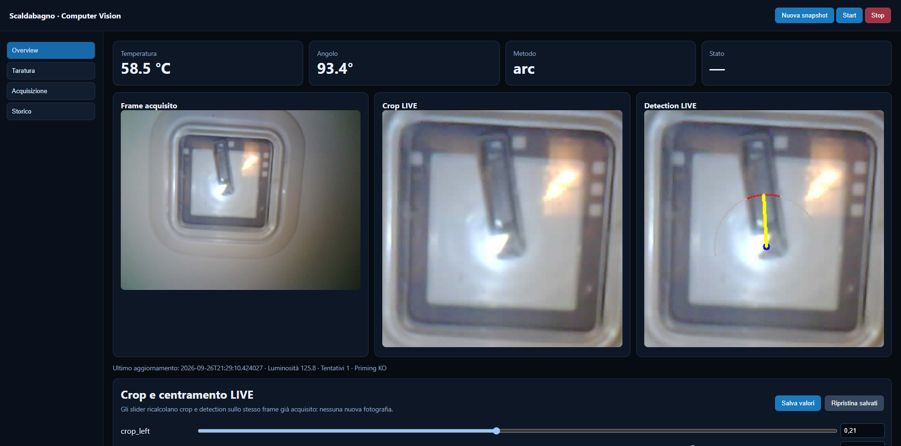
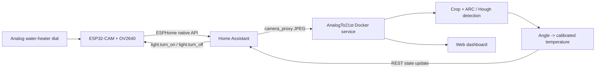

# AnalogTo21st

**Bring a perfectly usable analog appliance into the 21st century without electrically modifying it.**

AnalogTo21st is a small ESPHome + Home Assistant + OpenCV project born from a very specific problem: an electric water heater had a useful analog temperature dial, but no digital temperature sensor or smart interface.

Instead of replacing the heater, opening its mains wiring, or attaching electronics to the thermostat, an **ESP32-CAM observes the original dial**. A Docker service asks Home Assistant for a still frame, detects the needle, converts its angle into a calibrated temperature and publishes the result back to Home Assistant.

The repository is intentionally centered on the **water-heater implementation** rather than pretending to be a generic computer-vision framework. The reusable idea is the non-invasive retrofit pattern: *camera in, calibrated physical value out*.



## What this project does

- Uses an **AI Thinker-style ESP32-CAM / OV2640** configured with ESPHome.
- Exposes the camera and its on-board flash LED to **Home Assistant**.
- Keeps the ESP32 simple: the Docker service never talks directly to the camera.
- Turns the flash on through Home Assistant, waits for camera exposure to settle and deliberately discards a priming frame.
- Retries dark snapshots using frame luminance as a simple quality gate.
- Crops the dial and detects the needle using either:
  - **ARC sampling**: samples a configurable circular arc and finds the dark needle segment;
  - **Hough lines**: edge detection + line selection around the configured pivot.
- Supports `auto`, which tries ARC first and falls back to Hough.
- Converts the detected angle to °C through editable **multi-point calibration**.
- Publishes a Home Assistant sensor such as `sensor.scaldabagno_temperature`.
- Provides a web dashboard for live geometry tuning, calibration, acquisition settings and history.

## Architecture



The important design choice is that the Docker service uses **Home Assistant as the integration boundary**. It controls the ESPHome flash entity, retrieves the camera snapshot from Home Assistant and writes the resulting temperature back to Home Assistant.

## Why a camera?

For this use case the existing analog dial already represents the value we care about. Reading the dial optically has a few practical advantages:

- no mains-side modification of the appliance;
- no replacement thermistor or probe to install;
- the original control system remains untouched;
- the retrofit is reversible;
- the exact same visible value remains available to a human.

This is not intended to replace safety thermostats, thermal cut-outs, certified instrumentation or appliance control electronics. It is an observational retrofit.

## Repository layout

```text
AnalogTo21st/
├── app.py                       # Flask API, acquisition worker and HA integration
├── detector.py                  # Crop, ARC, Hough and angle->temperature logic
├── templates/
│   └── index.html               # Dashboard UI
├── esphome/
│   ├── scaldabagno.yaml         # ESP32-CAM / ESPHome example
│   └── secrets.example.yaml
├── assets/
│   └── dashboard.png            # Real v3 deployment screenshot
├── data/                        # Runtime config/history volume (not committed)
├── compose.yaml
├── Dockerfile
├── requirements.txt
├── .env.example
└── SECURITY.md
```

## Hardware

The reference implementation uses:

- ESP32-CAM compatible with the AI Thinker pinout;
- OV2640 camera;
- on-board GPIO4 flash LED;
- a fixed view of the water-heater temperature dial;
- Wi-Fi connectivity to the Home Assistant network.

Good mechanical alignment matters more than high image resolution. The reference ESPHome configuration uses **800×600 JPEG**, one PSRAM framebuffer and a very low idle frame rate because this project needs stable still images, not video.

## ESPHome setup

Copy the example secrets file:

```bash
cd esphome
cp secrets.example.yaml secrets.yaml
```

Fill in your Wi-Fi credentials, generate an ESPHome API encryption key and choose a strong OTA password. Then validate/flash `scaldabagno.yaml` with your normal ESPHome workflow.

The example deliberately does **not** contain a production IP address. DHCP works out of the box; add an ESPHome `manual_ip` block locally if your network requires one.

After Home Assistant discovers the node, note the actual entity IDs for:

- the flash light;
- the camera.

Entity IDs can differ depending on your ESPHome/Home Assistant naming history, so configure them in `.env` rather than editing the Python code.

## Docker setup

Copy the environment template:

```bash
cp .env.example .env
```

Edit `.env`:

```dotenv
HA_BASE_URL=http://homeassistant.local:8123
HA_TOKEN=YOUR_LONG_LIVED_ACCESS_TOKEN
HA_VERIFY_SSL=false
HA_LIGHT_ENTITY=light.espscaldabagno_scaldabagno_flash
HA_CAMERA_ENTITY=camera.espscaldabagno_scaldabagno_camera
HA_SENSOR_ENTITY=sensor.scaldabagno_temperature
DASHBOARD_PORT=5006
```

Create the persistent data directory and start the service:

```bash
mkdir -p data
docker compose up -d --build
```

Open:

```text
http://YOUR_DOCKER_HOST:5006
```

The container stores runtime values in:

- `/data/config.json` — crop, pivot, detector geometry, calibration and acquisition settings;
- `/data/history.jsonl` — recent measurements.

Both are bind-mounted to the local `data/` directory and intentionally ignored by Git.

## The v3 acquisition sequence

A read is more than a single HTTP request. The v3 code tries to make an ESP32-CAM behave predictably under changing exposure conditions:

1. Turn the ESPHome flash LED on through Home Assistant.
2. Wait for `led_warmup_seconds`.
3. Request and discard one **priming frame**.
4. Wait `snapshot_settle_seconds`.
5. Capture up to `max_snapshot_attempts` frames.
6. Measure mean luminance and accept the first frame above `min_brightness_retry_threshold`.
7. If every attempt is dark, keep the brightest captured frame rather than throwing the whole reading away.
8. Hold the flash briefly for `led_post_hold_seconds`, then switch it off.
9. Run the detector, convert angle to temperature, record history and publish the sensor to Home Assistant.

Those timing/retry values are editable from the **Acquisizione** page in the dashboard.

## Live crop and pivot tuning

The Overview page contains the v3 **Crop e centramento LIVE** controls shown in the screenshot.

Changing a geometry slider does **not** take another photograph. The browser posts the candidate geometry to `/api/reprocess`, and the backend recalculates crop + detection against the frame already held in RAM. This makes setup much faster and avoids waiting for a complete flash/snapshot cycle after every small adjustment.

The tunable geometry includes:

- crop boundaries;
- pivot X/Y ratios;
- ARC radius;
- ARC start/end angles;
- number of sampled points;
- dark-fraction threshold.

Use **Salva valori** only when the overlay is aligned correctly. **Ripristina salvati** reprocesses the cached frame using the last persisted geometry.

## ARC detector

ARC is the primary detector in the reference installation.

It samples grayscale intensity around a configurable circular arc centered on the needle pivot. The darkest contiguous segment is treated as the needle intersection with the arc. Its midpoint defines the needle direction.

The detection overlay shows:

- the configured pivot;
- sampled arc points;
- points classified as dark;
- the selected needle direction.

ARC is especially useful when the pivot is known and the needle reliably crosses a clean ring around it.

## Hough fallback

The Hough detector builds adaptive edge masks from grayscale and individual B/G/R channels, combines and closes them, then looks for line segments passing close to the configured pivot.

It is useful as a fallback when reflections or illumination make the ARC intensity profile ambiguous. In `auto` mode the service tries ARC first and uses Hough only when ARC does not return an angle.

## Calibration: angle -> temperature

Detection returns an angle; it does not inherently know what that angle means on a particular appliance.

The **Taratura** page stores multiple `(angle, temperature)` points. The first point establishes the angular origin and intermediate readings are linearly interpolated. A final `temp_offset` can be applied after interpolation.

The default points are examples only. Calibrate your own dial against a trusted reference measurement before relying on the value.

## HTTP endpoints

| Endpoint | Method | Purpose |
| --- | --- | --- |
| `/` | GET | Dashboard |
| `/health` | GET | Container health/status |
| `/api/state` | GET | Current state, settings and recent history |
| `/api/read` | POST | Trigger a complete new acquisition |
| `/api/reprocess` | POST | Re-run geometry/detection on the cached frame |
| `/api/settings` | POST | Persist editable settings |
| `/api/monitor/start` | POST | Enable periodic acquisition |
| `/api/monitor/stop` | POST | Disable periodic acquisition |
| `/api/history` | GET | Measurement history held in memory |
| `/image/raw` | GET | Last full acquired frame |
| `/image/crop` | GET | Current cropped dial |
| `/image/overlay` | GET | Current detector overlay |

## Security

The Home Assistant token in `.env` is a credential. Never commit it.

The dashboard itself does not implement user authentication. Run it on a trusted LAN, through Home Assistant, or behind an authenticated reverse proxy. See [SECURITY.md](SECURITY.md).

## Scope

AnalogTo21st is a hobby/experimental project for observing an existing analog indicator. It is **not** a safety controller and must not be used as the only protection against overheating or other hazardous appliance states.

The same approach can be adapted to other analog dials and gauges, but this repository intentionally ships a concrete, working water-heater implementation instead of abstracting the project into a framework prematurely.

## License

Copyright 2026 Francesco Raschi.

The repository is source-available under the **PolyForm Noncommercial License 1.0.0**. Noncommercial use, study, modification and redistribution are permitted according to that license. Commercial use requires a separate license.

See [LICENSE.md](LICENSE.md) and [COMMERCIAL-LICENSE.md](COMMERCIAL-LICENSE.md).

Third-party dependencies retain their own licenses.
